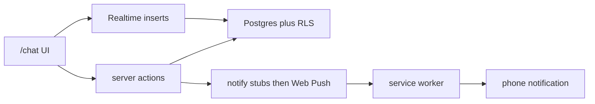

> **For agentic workers:** REQUIRED SUB-SKILL: Use superpowers:subagent-driven-development (recommended) or superpowers:executing-plans to implement this plan task-by-task. Steps use checkbox (`- [ ]`) syntax for tracking.

**Goal:** Add lean text DMs and named group chat on `/chat`, then Web Push so a phone (browser or Add to Home Screen) is pinged for new chat messages, announcements, and leave decisions.

**Architecture:** New Postgres tables with RLS. Writes go through existing-style server actions. The open thread uses Supabase Realtime `postgres_changes`. Web Push is VAPID + `web-push` + `push_subscriptions`; send failures never fail the original write. Chat is usable without push.

**Tech Stack:** Next.js 15 App Router, Supabase (Postgres, RLS, Realtime), Vitest, Playwright, `web-push`, existing Avatar / Button / TextArea / TextField / Toast / Toggle / EmptyState / Chip.

## Global Constraints

- Copy is lowercase and casual. Follow [docs/DESIGN.md](docs/DESIGN.md). No new color, type, or motion tokens. Page enter is `.pageEnter` only.
- V1 chat is text only: no files, reactions, threads, typing indicators, read receipts, edits, or deletes.
- Any active visible person (not `super_admin`) can DM any other visible person and can create a named group.
- Group: any member can add people; any member can leave; only `created_by` can remove others; creator leaving transfers `created_by` to the earliest remaining member.
- DM: exactly two members, find-or-create by `dm_key`, no leave, no third person.
- Message body 1–2000 chars. Group title 1–60 chars. Push preview 120 chars. Send rate limit 30/minute via existing `rateLimit`.
- Super admin stays off `/chat` (already true in [lib/layout/access.ts](lib/layout/access.ts); add an explicit test).
- Push never fails `sendMessage` / `postAnnouncement` / `decideLeave`. Delete subscriptions that return 410/404.
- iOS: notifications only after Add to Home Screen (Safari 16.4+). Say that on the `/chat` prompt card.
- Phase 1 (chat) must pass tests and be usable in the tab before Phase 2 (push) starts.
- On execution, first write the approved spec to [docs/superpowers/specs/2026-09-07-chat-and-web-push-design.md](docs/superpowers/specs/2026-09-07-chat-and-web-push-design.md) and this plan to [docs/superpowers/plans/2026-09-07-chat-and-web-push.md](docs/superpowers/plans/2026-09-07-chat-and-web-push.md).



## File map

Phase 1 create: [lib/chat/validate.ts](lib/chat/validate.ts), [lib/chat/unread.ts](lib/chat/unread.ts), [lib/chat/inbox.ts](lib/chat/inbox.ts), [lib/push/notify.ts](lib/push/notify.ts) (no-op stubs), [supabase/migrations/0011_chat_and_push.sql](supabase/migrations/0011_chat_and_push.sql), [app/(portal)/chat/actions.ts](app/(portal)/chat/actions.ts), [app/(portal)/chat/page.tsx](app/(portal)/chat/page.tsx), [app/(portal)/chat/[id]/page.tsx](app/(portal)/chat/[id]/page.tsx), [components/chat/ChatInbox.tsx](components/chat/ChatInbox.tsx), [components/chat/ChatThread.tsx](components/chat/ChatThread.tsx), [components/chat/NewChatDialog.tsx](components/chat/NewChatDialog.tsx), [components/chat/Chat.module.scss](components/chat/Chat.module.scss), [e2e/chat.spec.ts](e2e/chat.spec.ts)

Phase 1 modify: [lib/types.ts](lib/types.ts), [lib/rls/policies.ts](lib/rls/policies.ts), [supabase/tests/rls.test.ts](supabase/tests/rls.test.ts), [lib/layout/navItems.ts](lib/layout/navItems.ts), [lib/layout/access.ts](lib/layout/access.ts), [lib/layout/access.test.ts](lib/layout/access.test.ts), [components/layout/navItems.test.ts](components/layout/navItems.test.ts), [components/layout/MobileNav.tsx](components/layout/MobileNav.tsx), [components/layout/Sidebar.tsx](components/layout/Sidebar.tsx), [components/layout/AppShell.tsx](components/layout/AppShell.tsx), [app/(portal)/layout.tsx](app/(portal)/layout.tsx), [app/anon/page.tsx](app/anon/page.tsx), [components/team/TeamClient.tsx](components/team/TeamClient.tsx)

Phase 2 create: [lib/push/payload.ts](lib/push/payload.ts), [lib/push/validate.ts](lib/push/validate.ts), [lib/push/send.ts](lib/push/send.ts), [lib/push/register.ts](lib/push/register.ts), [components/chat/PushToggle.tsx](components/chat/PushToggle.tsx), [public/sw.js](public/sw.js), [app/manifest.ts](app/manifest.ts), [app/pwa/[size]/route.tsx](app/pwa/[size]/route.tsx)

Phase 2 modify: [lib/push/notify.ts](lib/push/notify.ts), [app/(portal)/announcements/actions.ts](app/(portal)/announcements/actions.ts), [app/(portal)/leaves/actions.ts](app/(portal)/leaves/actions.ts), [.env.example](.env.example), [package.json](package.json)

---

## Phase 1 — Lean chat

### Task 1: Chat validators

**Files:**
- Create: `lib/chat/validate.ts`
- Test: `lib/chat/validate.test.ts`

**Interfaces:**
- Produces:
  - `CHAT_BODY_MAX = 2000`
  - `CHAT_TITLE_MAX = 60`
  - `CHAT_SEND_RATE_MAX = 30`
  - `CHAT_SEND_RATE_WINDOW_MS = 60_000`
  - `dmKey(a: string, b: string): string`
  - `validateChatBody(raw: string): string | null`
  - `validateGroupTitle(raw: string): string | null`
  - `validateDmTarget(input: { me: string; other: { id: string; active: boolean; role: ProfileRole } | null }): string | null`
  - `uniqueMemberIds(me: string, ids: string[]): string[]`
  - `nextCreatorId(input: { leavingId: string; createdBy: string; members: { userId: string; joinedAt: string }[] }): string | null`
  - `canRemoveGroupMember(input: { actorId: string; createdBy: string; targetId: string; kind: "dm" | "group" }): boolean`

- [ ] **Step 1: Write the failing tests**

```ts
import { describe, expect, it } from "vitest";
import {
  canRemoveGroupMember,
  dmKey,
  nextCreatorId,
  uniqueMemberIds,
  validateChatBody,
  validateDmTarget,
  validateGroupTitle,
} from "./validate";

describe("dmKey", () => {
  it("sorts uuids so the pair is stable", () => {
    expect(dmKey("b", "a")).toBe("a:b");
    expect(dmKey("a", "b")).toBe("a:b");
  });
});

describe("validateChatBody", () => {
  it("rejects empty and too long", () => {
    expect(validateChatBody("   ")).toBe("type something");
    expect(validateChatBody("x".repeat(2001))).toBe("that's a novel. 2000 chars max.");
    expect(validateChatBody("hey")).toBeNull();
  });
});

describe("validateGroupTitle", () => {
  it("rejects empty and too long", () => {
    expect(validateGroupTitle("  ")).toBe("group needs a name");
    expect(validateGroupTitle("x".repeat(61))).toBe("60 chars max.");
    expect(validateGroupTitle("eng squad")).toBeNull();
  });
});

describe("validateDmTarget", () => {
  it("blocks self, missing, inactive, and super_admin", () => {
    expect(validateDmTarget({ me: "a", other: { id: "a", active: true, role: "employee" } })).toBe("that's you");
    expect(validateDmTarget({ me: "a", other: null })).toBe("can't message them");
    expect(validateDmTarget({ me: "a", other: { id: "b", active: false, role: "employee" } })).toBe("can't message them");
    expect(validateDmTarget({ me: "a", other: { id: "b", active: true, role: "super_admin" } })).toBe("can't message them");
    expect(validateDmTarget({ me: "a", other: { id: "b", active: true, role: "employee" } })).toBeNull();
  });
});

describe("uniqueMemberIds", () => {
  it("always includes me and drops dupes", () => {
    expect(uniqueMemberIds("me", ["a", "me", "a", "b"])).toEqual(["me", "a", "b"]);
  });
});

describe("nextCreatorId", () => {
  it("keeps creator if someone else leaves", () => {
    expect(
      nextCreatorId({
        leavingId: "b",
        createdBy: "a",
        members: [
          { userId: "a", joinedAt: "2026-01-01T00:00:00Z" },
          { userId: "b", joinedAt: "2026-01-02T00:00:00Z" },
        ],
      }),
    ).toBe("a");
  });
  it("hands creator to earliest remaining member", () => {
    expect(
      nextCreatorId({
        leavingId: "a",
        createdBy: "a",
        members: [
          { userId: "a", joinedAt: "2026-01-01T00:00:00Z" },
          { userId: "c", joinedAt: "2026-01-03T00:00:00Z" },
          { userId: "b", joinedAt: "2026-01-02T00:00:00Z" },
        ],
      }),
    ).toBe("b");
  });
  it("returns null when the last member leaves", () => {
    expect(nextCreatorId({ leavingId: "a", createdBy: "a", members: [{ userId: "a", joinedAt: "2026-01-01T00:00:00Z" }] })).toBeNull();
  });
});

describe("canRemoveGroupMember", () => {
  it("only the group creator can remove someone else", () => {
    expect(canRemoveGroupMember({ actorId: "a", createdBy: "a", targetId: "b", kind: "group" })).toBe(true);
    expect(canRemoveGroupMember({ actorId: "a", createdBy: "a", targetId: "a", kind: "group" })).toBe(false);
    expect(canRemoveGroupMember({ actorId: "b", createdBy: "a", targetId: "c", kind: "group" })).toBe(false);
    expect(canRemoveGroupMember({ actorId: "a", createdBy: "a", targetId: "b", kind: "dm" })).toBe(false);
  });
});
```

- [ ] **Step 2: Run tests to verify they fail**

Run: `npx vitest run lib/chat/validate.test.ts`
Expected: FAIL with `Cannot find module './validate'`

- [ ] **Step 3: Write minimal implementation**

```ts
import type { ProfileRole } from "@/lib/types";

export const CHAT_BODY_MAX = 2000;
export const CHAT_TITLE_MAX = 60;
export const CHAT_SEND_RATE_MAX = 30;
export const CHAT_SEND_RATE_WINDOW_MS = 60_000;

export function dmKey(a: string, b: string): string {
  return a < b ? `${a}:${b}` : `${b}:${a}`;
}

export function validateChatBody(raw: string): string | null {
  const body = raw.trim();
  if (!body) return "type something";
  if (body.length > CHAT_BODY_MAX) return "that's a novel. 2000 chars max.";
  return null;
}

export function validateGroupTitle(raw: string): string | null {
  const title = raw.trim();
  if (!title) return "group needs a name";
  if (title.length > CHAT_TITLE_MAX) return "60 chars max.";
  return null;
}

export function validateDmTarget(input: {
  me: string;
  other: { id: string; active: boolean; role: ProfileRole } | null;
}): string | null {
  if (!input.other || !input.other.active || input.other.role === "super_admin") return "can't message them";
  if (input.other.id === input.me) return "that's you";
  return null;
}

export function uniqueMemberIds(me: string, ids: string[]): string[] {
  return [me, ...ids.filter((id) => id && id !== me && ids.includes(id))].filter(
    (id, i, all) => all.indexOf(id) === i,
  );
}

export function nextCreatorId(input: {
  leavingId: string;
  createdBy: string;
  members: { userId: string; joinedAt: string }[];
}): string | null {
  const remaining = input.members
    .filter((m) => m.userId !== input.leavingId)
    .sort((a, b) => a.joinedAt.localeCompare(b.joinedAt) || a.userId.localeCompare(b.userId));
  if (input.leavingId !== input.createdBy) return input.createdBy;
  return remaining[0]?.userId ?? null;
}

export function canRemoveGroupMember(input: {
  actorId: string;
  createdBy: string;
  targetId: string;
  kind: "dm" | "group";
}): boolean {
  return input.kind === "group" && input.actorId === input.createdBy && input.targetId !== input.actorId;
}
```

- [ ] **Step 4: Run tests to verify they pass**

Run: `npx vitest run lib/chat/validate.test.ts`
Expected: PASS

- [ ] **Step 5: Commit**

```bash
git add lib/chat/validate.ts lib/chat/validate.test.ts
git commit -m "feat(chat): add validators for dms and groups"
```

---

### Task 2: Unread, preview, and inbox assembly

**Files:**
- Create: `lib/chat/unread.ts`, `lib/chat/inbox.ts`
- Test: `lib/chat/unread.test.ts`, `lib/chat/inbox.test.ts`
- Modify: `lib/types.ts` (append chat types)

**Interfaces:**
- Consumes: none from Task 1 except later actions use both
- Produces:
  - `CHAT_PREVIEW_MAX = 120`
  - `chatPreview(body: string, max?: number): string`
  - `isUnreadMessage(input: { senderId: string; createdAt: string; me: string; lastReadAt: string | null }): boolean`
  - `unreadConversationCount(rows: { unread: number }[]): number`
  - `buildInboxRows(input: InboxInput): InboxRow[]`
  - Types `ConversationKind`, `Conversation`, `ConversationMember`, `ChatMessage`, `InboxRow` on `lib/types.ts`

- [ ] **Step 1: Append types to `lib/types.ts`**

```ts
export type ConversationKind = "dm" | "group";

export type Conversation = {
  id: string;
  kind: ConversationKind;
  title: string;
  dm_key: string | null;
  created_by: string;
  created_at: string;
  last_message_at: string;
};

export type ConversationMember = {
  conversation_id: string;
  user_id: string;
  joined_at: string;
  last_read_at: string | null;
};

export type ChatMessage = {
  id: string;
  conversation_id: string;
  sender_id: string;
  body: string;
  created_at: string;
};

export type InboxRow = {
  id: string;
  kind: ConversationKind;
  title: string;
  avatarName: string;
  avatarColor: string;
  lastPreview: string;
  lastAt: string;
  unread: number;
  otherUserId: string | null;
};
```

- [ ] **Step 2: Write failing tests**

`lib/chat/unread.test.ts`:

```ts
import { describe, expect, it } from "vitest";
import { CHAT_PREVIEW_MAX, chatPreview, isUnreadMessage, unreadConversationCount } from "./unread";

describe("chatPreview", () => {
  it("trims and caps at 120", () => {
    expect(chatPreview("  hi  ")).toBe("hi");
    expect(chatPreview("x".repeat(121)).length).toBe(CHAT_PREVIEW_MAX);
  });
});

describe("isUnreadMessage", () => {
  it("ignores my own messages", () => {
    expect(isUnreadMessage({ senderId: "me", createdAt: "2026-01-02T00:00:00Z", me: "me", lastReadAt: null })).toBe(false);
  });
  it("counts others after last_read_at or when never read", () => {
    expect(isUnreadMessage({ senderId: "b", createdAt: "2026-01-02T00:00:00Z", me: "me", lastReadAt: null })).toBe(true);
    expect(isUnreadMessage({ senderId: "b", createdAt: "2026-01-02T00:00:00Z", me: "me", lastReadAt: "2026-01-03T00:00:00Z" })).toBe(false);
    expect(isUnreadMessage({ senderId: "b", createdAt: "2026-01-04T00:00:00Z", me: "me", lastReadAt: "2026-01-03T00:00:00Z" })).toBe(true);
  });
});

describe("unreadConversationCount", () => {
  it("counts conversations that have unread, not messages", () => {
    expect(unreadConversationCount([{ unread: 4 }, { unread: 0 }, { unread: 1 }])).toBe(2);
  });
});
```

`lib/chat/inbox.test.ts`:

```ts
import { describe, expect, it } from "vitest";
import { buildInboxRows } from "./inbox";

const convo = {
  id: "c1",
  kind: "dm" as const,
  title: "",
  dm_key: "a:b",
  created_by: "a",
  created_at: "2026-01-01T00:00:00Z",
  last_message_at: "2026-01-02T00:00:00Z",
};

describe("buildInboxRows", () => {
  it("titles a dm with the other person and counts unread", () => {
    const rows = buildInboxRows({
      me: "a",
      conversations: [convo],
      members: [
        { conversation_id: "c1", user_id: "a", joined_at: "2026-01-01T00:00:00Z", last_read_at: "2026-01-01T12:00:00Z" },
        { conversation_id: "c1", user_id: "b", joined_at: "2026-01-01T00:00:00Z", last_read_at: null },
      ],
      people: [
        { id: "a", full_name: "Ada", avatar_color: "#7048B6" },
        { id: "b", full_name: "Bea", avatar_color: "#0E9488" },
      ],
      messages: [
        { id: "m1", conversation_id: "c1", sender_id: "b", body: "hello there", created_at: "2026-01-02T00:00:00Z" },
      ],
    });
    expect(rows[0]?.title).toBe("Bea");
    expect(rows[0]?.otherUserId).toBe("b");
    expect(rows[0]?.unread).toBe(1);
    expect(rows[0]?.lastPreview).toBe("hello there");
  });

  it("titles a group with the group title", () => {
    const rows = buildInboxRows({
      me: "a",
      conversations: [{ ...convo, id: "g1", kind: "group", title: "eng squad", dm_key: null }],
      members: [{ conversation_id: "g1", user_id: "a", joined_at: "2026-01-01T00:00:00Z", last_read_at: null }],
      people: [{ id: "a", full_name: "Ada", avatar_color: "#7048B6" }],
      messages: [],
    });
    expect(rows[0]?.title).toBe("eng squad");
    expect(rows[0]?.otherUserId).toBeNull();
  });
});
```

- [ ] **Step 3: Run tests to verify they fail**

Run: `npx vitest run lib/chat/unread.test.ts lib/chat/inbox.test.ts`
Expected: FAIL with missing modules

- [ ] **Step 4: Implement**

`lib/chat/unread.ts`:

```ts
export const CHAT_PREVIEW_MAX = 120;

export function chatPreview(body: string, max = CHAT_PREVIEW_MAX): string {
  const text = body.trim();
  return text.length <= max ? text : text.slice(0, max);
}

export function isUnreadMessage(input: {
  senderId: string;
  createdAt: string;
  me: string;
  lastReadAt: string | null;
}): boolean {
  if (input.senderId === input.me) return false;
  if (!input.lastReadAt) return true;
  return input.createdAt > input.lastReadAt;
}

export function unreadConversationCount(rows: { unread: number }[]): number {
  return rows.filter((r) => r.unread > 0).length;
}
```

`lib/chat/inbox.ts`:

```ts
import { chatPreview, isUnreadMessage } from "./unread";
import type { ChatMessage, Conversation, ConversationMember, InboxRow } from "@/lib/types";

export type InboxPerson = { id: string; full_name: string; avatar_color: string };

export type InboxInput = {
  me: string;
  conversations: Conversation[];
  members: ConversationMember[];
  people: InboxPerson[];
  messages: ChatMessage[];
};

export function buildInboxRows(input: InboxInput): InboxRow[] {
  const people = new Map(input.people.map((p) => [p.id, p]));
  const sorted = [...input.conversations].sort((a, b) => b.last_message_at.localeCompare(a.last_message_at));
  return sorted.map((c) => {
    const members = input.members.filter((m) => m.conversation_id === c.id);
    const mine = members.find((m) => m.user_id === input.me);
    const other = members.find((m) => m.user_id !== input.me);
    const otherPerson = other ? people.get(other.user_id) : undefined;
    const convMessages = input.messages.filter((m) => m.conversation_id === c.id);
    const last = [...convMessages].sort((a, b) => b.created_at.localeCompare(a.created_at))[0];
    const unread = convMessages.filter((m) =>
      isUnreadMessage({
        senderId: m.sender_id,
        createdAt: m.created_at,
        me: input.me,
        lastReadAt: mine?.last_read_at ?? null,
      }),
    ).length;
    const title = c.kind === "group" ? c.title : (otherPerson?.full_name ?? "chat");
    const avatarName = c.kind === "group" ? c.title : (otherPerson?.full_name ?? "?");
    return {
      id: c.id,
      kind: c.kind,
      title,
      avatarName,
      avatarColor: otherPerson?.avatar_color ?? "#7048B6",
      lastPreview: last ? chatPreview(last.body) : "",
      lastAt: last?.created_at ?? c.last_message_at,
      unread,
      otherUserId: c.kind === "dm" ? (other?.user_id ?? null) : null,
    };
  });
}
```

- [ ] **Step 5: Run tests**

Run: `npx vitest run lib/chat/unread.test.ts lib/chat/inbox.test.ts`
Expected: PASS

- [ ] **Step 6: Commit**

```bash
git add lib/types.ts lib/chat/unread.ts lib/chat/unread.test.ts lib/chat/inbox.ts lib/chat/inbox.test.ts
git commit -m "feat(chat): assemble inbox rows and unread counts"
```

---

### Task 3: Nav, access, and policy helpers

**Files:**
- Modify: [lib/rls/policies.ts](lib/rls/policies.ts), [supabase/tests/rls.test.ts](supabase/tests/rls.test.ts), [lib/layout/navItems.ts](lib/layout/navItems.ts), [components/layout/navItems.test.ts](components/layout/navItems.test.ts), [lib/layout/access.ts](lib/layout/access.ts), [lib/layout/access.test.ts](lib/layout/access.test.ts)

**Interfaces:**
- Produces: `canUseChat(role: ProfileRole): boolean`
- `getNavItems(role, unreadAnnouncements = 0, unreadChat = 0)`
- `pageMeta` matches `/chat/:id` to the chat item

- [ ] **Step 1: Write failing tests**

Add to `supabase/tests/rls.test.ts`:

```ts
import { canUseChat } from "@/lib/rls/policies";

it("lets everyone except super_admin use chat", () => {
  expect(canUseChat("employee")).toBe(true);
  expect(canUseChat("lead")).toBe(true);
  expect(canUseChat("admin")).toBe(true);
  expect(canUseChat("cxo")).toBe(true);
  expect(canUseChat("super_admin")).toBe(false);
});
```

In `lib/layout/access.test.ts` add:

```ts
it("keeps super_admin off chat and lets employees in", () => {
  expect(canVisitPath("super_admin", "/chat")).toBe(false);
  expect(canVisitPath("super_admin", "/chat/abc")).toBe(false);
  expect(canVisitPath("employee", "/chat")).toBe(true);
  expect(canVisitPath("employee", "/chat/abc")).toBe(true);
});
```

Update `components/layout/navItems.test.ts`: employee length **10**, admin/cxo length **12**, assert `chat` sits after `dash`, `getNavItems("employee", 0, 3)` sets chat badge `3`, and `pageMeta("/chat/xyz", "employee").id === "chat"`.

- [ ] **Step 2: Run tests — expect FAIL**

Run: `npx vitest run supabase/tests/rls.test.ts lib/layout/access.test.ts components/layout/navItems.test.ts`

- [ ] **Step 3: Implement**

In `lib/rls/policies.ts`:

```ts
export function canUseChat(role: ProfileRole): boolean {
  return role !== "super_admin";
}
```

In `lib/layout/navItems.ts`, add after the dash item:

```ts
{
  id: "chat",
  href: "/chat",
  label: "chat",
  title: "chat",
  sub: "dms and groups. no slack tax.",
},
```

Change signature and badges:

```ts
export function getNavItems(
  role: ProfileRole,
  unreadAnnouncements = 0,
  unreadChat = 0,
): (NavItem & { badge: number | null })[] {
  // existing items assembly unchanged
  return items.map((item) => ({
    ...item,
    badge:
      item.id === "ann" && unreadAnnouncements > 0
        ? unreadAnnouncements
        : item.id === "chat" && unreadChat > 0
          ? unreadChat
          : null,
  }));
}

export function pageMeta(pathname: string, role: ProfileRole) {
  const items = getNavItems(role);
  return (
    items.find((i) => i.href === pathname) ??
    items.find((i) => i.href !== "/" && pathname.startsWith(`${i.href}/`)) ??
    items[0]
  );
}
```

`canVisitPath` already blocks super_admin from `/chat` because they only get settings/users/holidays. Do not change that function unless a test fails.

- [ ] **Step 4: Run tests — expect PASS**

- [ ] **Step 5: Commit**

```bash
git add lib/rls/policies.ts supabase/tests/rls.test.ts lib/layout/navItems.ts components/layout/navItems.test.ts lib/layout/access.test.ts
git commit -m "feat(chat): add nav item and chat access helpers"
```

---

### Task 4: Migration

**Files:**
- Create: `supabase/migrations/0011_chat_and_push.sql`

**Interfaces:**
- Produces tables `conversations`, `conversation_members`, `messages`, `push_subscriptions`
- Produces `is_conversation_member(uuid)`, `unread_chat_count()`, trigger `touch_conversation_last_message`
- Adds `messages` and `conversation_members` to `supabase_realtime`

- [ ] **Step 1: Write the migration** (no app code yet; verify with `npx supabase db reset` if Docker is available, otherwise review SQL)

```sql
create table public.conversations (
  id uuid primary key default gen_random_uuid(),
  kind text not null check (kind in ('dm', 'group')),
  title text not null default '',
  dm_key text unique,
  created_by uuid not null references public.profiles (id) on delete cascade,
  created_at timestamptz not null default now(),
  last_message_at timestamptz not null default now(),
  check ((kind = 'dm' and dm_key is not null) or (kind = 'group' and dm_key is null))
);

create table public.conversation_members (
  conversation_id uuid not null references public.conversations (id) on delete cascade,
  user_id uuid not null references public.profiles (id) on delete cascade,
  joined_at timestamptz not null default now(),
  last_read_at timestamptz,
  primary key (conversation_id, user_id)
);

create table public.messages (
  id uuid primary key default gen_random_uuid(),
  conversation_id uuid not null references public.conversations (id) on delete cascade,
  sender_id uuid not null references public.profiles (id) on delete cascade,
  body text not null,
  created_at timestamptz not null default now()
);

create index messages_conversation_created_idx
  on public.messages (conversation_id, created_at);

create table public.push_subscriptions (
  id uuid primary key default gen_random_uuid(),
  user_id uuid not null references public.profiles (id) on delete cascade,
  endpoint text not null unique,
  p256dh text not null,
  auth text not null,
  created_at timestamptz not null default now()
);

create or replace function public.is_conversation_member(cid uuid)
returns boolean
language sql
stable
security definer
set search_path = public
as $$
  select exists (
    select 1 from public.conversation_members
    where conversation_id = cid and user_id = auth.uid()
  )
$$;

create or replace function public.unread_chat_count()
returns integer
language sql
stable
security definer
set search_path = public
as $$
  select count(distinct m.conversation_id)::int
  from public.messages m
  join public.conversation_members me
    on me.conversation_id = m.conversation_id
   and me.user_id = auth.uid()
  where m.sender_id <> auth.uid()
    and (me.last_read_at is null or m.created_at > me.last_read_at)
$$;

create or replace function public.touch_conversation_last_message()
returns trigger
language plpgsql
set search_path = public
as $$
begin
  update public.conversations
  set last_message_at = new.created_at
  where id = new.conversation_id;
  return new;
end;
$$;

create trigger messages_touch_conversation
  after insert on public.messages
  for each row execute function public.touch_conversation_last_message();

alter table public.conversations enable row level security;
alter table public.conversation_members enable row level security;
alter table public.messages enable row level security;
alter table public.push_subscriptions enable row level security;

create policy conversations_select on public.conversations
  for select to authenticated
  using (public.is_conversation_member(id));

create policy conversations_insert on public.conversations
  for insert to authenticated
  with check (created_by = auth.uid());

create policy conversations_update on public.conversations
  for update to authenticated
  using (public.is_conversation_member(id))
  with check (public.is_conversation_member(id));

create policy members_select on public.conversation_members
  for select to authenticated
  using (public.is_conversation_member(conversation_id));

create policy members_insert on public.conversation_members
  for insert to authenticated
  with check (
    exists (
      select 1 from public.conversations c
      where c.id = conversation_id and c.created_by = auth.uid()
    )
    or public.is_conversation_member(conversation_id)
  );

create policy members_update on public.conversation_members
  for update to authenticated
  using (user_id = auth.uid())
  with check (user_id = auth.uid());

create policy members_delete on public.conversation_members
  for delete to authenticated
  using (
    user_id = auth.uid()
    or exists (
      select 1 from public.conversations c
      where c.id = conversation_id and c.created_by = auth.uid()
    )
  );

create policy messages_select on public.messages
  for select to authenticated
  using (public.is_conversation_member(conversation_id));

create policy messages_insert on public.messages
  for insert to authenticated
  with check (sender_id = auth.uid() and public.is_conversation_member(conversation_id));

create policy push_select on public.push_subscriptions
  for select to authenticated
  using (user_id = auth.uid());

create policy push_insert on public.push_subscriptions
  for insert to authenticated
  with check (user_id = auth.uid());

create policy push_delete on public.push_subscriptions
  for delete to authenticated
  using (user_id = auth.uid());

grant execute on function public.is_conversation_member(uuid) to authenticated;
grant execute on function public.unread_chat_count() to authenticated;

alter publication supabase_realtime add table public.messages;
alter publication supabase_realtime add table public.conversation_members;
```

- [ ] **Step 2: Reset local DB if Docker is running**

Run: `npx supabase db reset`
Expected: migrations apply, seed still loads

- [ ] **Step 3: Commit**

```bash
git add supabase/migrations/0011_chat_and_push.sql
git commit -m "feat(chat): add conversation, message, and push tables"
```

---

### Task 5: Server actions and notify stubs

**Files:**
- Create: `lib/push/notify.ts`, `app/(portal)/chat/actions.ts`
- Test: `lib/push/notify.test.ts` (stubs resolve)

**Interfaces:**
- Consumes: validators from Task 1, `canUseChat`
- Produces:
  - `openDm(otherUserId: string): Promise<{ ok: true; id: string } | { ok: false; error: string }>`
  - `createGroup(title: string, memberIds: string[]): Promise<{ ok: true; id: string } | { ok: false; error: string }>`
  - `sendMessage(conversationId: string, body: string): Promise<{ ok: true; id: string } | { ok: false; error: string }>`
  - `markRead(conversationId: string): Promise<{ ok: true } | { ok: false; error: string }>`
  - `addGroupMembers(conversationId: string, userIds: string[]): Promise<{ ok: true } | { ok: false; error: string }>`
  - `removeGroupMember(conversationId: string, userId: string): Promise<{ ok: true } | { ok: false; error: string }>`
  - `leaveGroup(conversationId: string): Promise<{ ok: true } | { ok: false; error: string }>`
  - `notifyChatMessage(...)` no-op
  - `notifyAnnouncement(...)` no-op
  - `notifyLeaveDecision(...)` no-op

- [ ] **Step 1: Stubs**

`lib/push/notify.ts`:

```ts
export async function notifyChatMessage(_input: {
  conversationId: string;
  senderId: string;
  senderName: string;
  groupTitle: string | null;
  body: string;
  memberIds: string[];
}): Promise<void> {}

export async function notifyAnnouncement(_input: {
  announcementId: string;
  authorId: string;
  title: string;
}): Promise<void> {}

export async function notifyLeaveDecision(_input: {
  requestId: string;
  requesterId: string;
  type: string;
  status: "approved" | "rejected";
}): Promise<void> {}
```

`lib/push/notify.test.ts` asserts each function resolves.

- [ ] **Step 2: Implement `app/(portal)/chat/actions.ts`**

Follow [app/(portal)/leaves/actions.ts](app/(portal)/leaves/actions.ts): `"use server"`, `requireProfile()`, `createClient()` from [lib/supabase/server.ts](lib/supabase/server.ts), return `{ ok, error }`.

Shared guard at the top of each action:

```ts
const profile = await requireProfile();
if (!canUseChat(profile.role)) return { ok: false as const, error: "not in that chat" };
const supabase = await createClient();
```

`openDm`:
- Load other profile `id, active, role`
- `validateDmTarget`
- `key = dmKey(profile.id, otherUserId)`
- Select conversation by `dm_key`; if found return `{ ok: true, id }`
- Insert `{ kind: "dm", title: "", dm_key: key, created_by: profile.id }` then insert both members
- On unique `dm_key` race, re-select and return existing id

`createGroup`:
- `validateGroupTitle`
- `memberIds = uniqueMemberIds(profile.id, memberIds)`
- Insert `{ kind: "group", title: title.trim(), dm_key: null, created_by: profile.id }`
- Insert a member row per id

`sendMessage`:
- `validateChatBody`
- If `!rateLimit(\`chat:${profile.id}\`, CHAT_SEND_RATE_MAX, CHAT_SEND_RATE_WINDOW_MS)` return `{ ok: false, error: "slow down" }`
- Confirm membership (`conversation_members` for this user + id)
- Insert message; on success load conversation title + member ids + sender name
- `void notifyChatMessage({...}).catch(() => {})`
- Return `{ ok: true, id: message.id }`

`markRead`:
- Update `conversation_members.last_read_at` where `conversation_id` and `user_id = profile.id`

`addGroupMembers`:
- Load conversation; if `kind !== "group"` or caller not a member, `not in that chat`
- Filter targets with the same rules as `validateDmTarget`
- Insert missing members

`removeGroupMember`:
- Load conversation + `canRemoveGroupMember`
- Delete that member row
- Error copy: `only the creator can remove people`

`leaveGroup`:
- Load conversation; must be group and a member
- Compute `nextCreatorId`; if it differs from `created_by` and is not null, update `conversations.created_by`
- Delete own membership

- [ ] **Step 3: Run stub tests**

Run: `npx vitest run lib/push/notify.test.ts`
Expected: PASS

- [ ] **Step 4: Commit**

```bash
git add lib/push/notify.ts lib/push/notify.test.ts app/(portal)/chat/actions.ts
git commit -m "feat(chat): add dm, group, and send actions"
```

---

### Task 6: Chat UI, realtime, team message button

**Files:**
- Create: `components/chat/Chat.module.scss`, `components/chat/NewChatDialog.tsx`, `components/chat/ChatInbox.tsx`, `components/chat/ChatThread.tsx`, `app/(portal)/chat/page.tsx`, `app/(portal)/chat/[id]/page.tsx`
- Modify: [components/team/TeamClient.tsx](components/team/TeamClient.tsx), [components/layout/MobileNav.tsx](components/layout/MobileNav.tsx), [components/layout/Sidebar.tsx](components/layout/Sidebar.tsx), [components/layout/AppShell.tsx](components/layout/AppShell.tsx), [app/(portal)/layout.tsx](app/(portal)/layout.tsx), [app/anon/page.tsx](app/anon/page.tsx)

**Interfaces:**
- Consumes: actions from Task 5, `buildInboxRows`, `matchesMember` from [lib/team/search.ts](lib/team/search.ts), `createClient` from [lib/supabase/client.ts](lib/supabase/client.ts)
- Inbox people list: active profiles `neq role super_admin`, same query as [app/(portal)/team/page.tsx](app/(portal)/team/page.tsx)

UI rules (do not invent tokens):
- Split pane from `768px`. Mobile: list on `/chat`, thread on `/chat/[id]`.
- Existing fade overlay dialog (team profile pattern) for new chat and group members.
- Yours: right + `background: $accent-wash`. Theirs: left + `Avatar`.
- Composer: existing `TextArea` + `Button`. Enter sends, Shift+Enter newline.
- Optimistic append with `id: "temp:{timestamp}"`; drop when realtime insert matches `sender_id + body`.
- `markRead` on thread mount and on each incoming message while that thread is open.
- Empty inbox: `EmptyState` title `no chats yet` body `start a dm or a group.`
- Empty pane: `pick a human or start a group.`
- Missing thread: `this chat is gone or you're not in it`
- Toast errors with the action `error` string.

Layout wiring:
- `AppShell` / `Sidebar` gain `unreadChat = 0` and call `getNavItems(role, unread, unreadChat)`.
- Portal layout: `const { data: unreadChat } = await supabase.rpc("unread_chat_count")`.
- `MobileNav` `PRIMARY` becomes `dash`, `chat`, `leaves`, `burgers`. Add `ChatTeardrop` to both icon maps. Anon stays in more.
- Team profile (other people, not editing): `Button` **message** calls `openDm(open.id)` then `router.push(\`/chat/${id}\`)`.

Realtime in `ChatThread`:

```ts
const supabase = createClient();
const channel = supabase
  .channel(`chat:${conversationId}`)
  .on(
    "postgres_changes",
    { event: "INSERT", schema: "public", table: "messages", filter: `conversation_id=eq.${conversationId}` },
    (payload) => { /* append ChatMessage; skip if id already present */ },
  )
  .subscribe();
```

On `visibilitychange` to visible, refetch messages for that id (silent).

`NewChatDialog`: search with `matchesMember`. One selected person → `openDm`. Two or more → title field + `createGroup`.

Group header menu: members sheet — add people, leave, and (if `created_by === me`) remove.

`/chat/page.tsx` loads inbox data + people, renders `ChatInbox` + empty pane + `NewChatDialog`.
`/chat/[id]/page.tsx` loads the same inbox plus that thread’s messages/members; if not a member, show the gone empty state. Desktop split: inbox + thread.

- [ ] **Step 1: Implement the files above** (no new motion; `.pageEnter` on the page wrap only)
- [ ] **Step 2: Run unit tests**

Run: `npx vitest run`
Expected: PASS (nav lengths now 10 / 12)

- [ ] **Step 3: Commit**

```bash
git add app/\(portal\)/chat components/chat components/team/TeamClient.tsx components/layout app/\(portal\)/layout.tsx app/anon/page.tsx
git commit -m "feat(chat): add inbox, live thread, and team message button"
```

---

### Task 7: Chat Playwright + Phase 1 verify

**Files:**
- Create: `e2e/chat.spec.ts`

- [ ] **Step 1: Write the spec** (same level as [e2e/leaves.spec.ts](e2e/leaves.spec.ts) — no TOTP login helper exists)

```ts
import { expect, test } from "@playwright/test";

test("chat route is protected", async ({ page }) => {
  await page.goto("/chat");
  await expect(page).toHaveURL(/login/);
});

test("chat thread route is protected", async ({ page }) => {
  await page.goto("/chat/00000000-0000-0000-0000-000000000000");
  await expect(page).toHaveURL(/login/);
});
```

- [ ] **Step 2: Run**

Run: `npx vitest run && npx playwright test e2e/chat.spec.ts`
Expected: PASS

- [ ] **Step 3: Manual check if a local session exists** — open `/chat`, start a DM, send, confirm the other browser/tab updates live. If no second user, create one via `/users`.
- [ ] **Step 4: Commit**

```bash
git add e2e/chat.spec.ts
git commit -m "test(chat): protect /chat routes"
```

Phase 1 is done when those commands pass. Do not start Phase 2 until they do.

---

## Phase 2 — Web Push

### Task 8: Push payloads and subscription validation

**Files:**
- Create: `lib/push/payload.ts`, `lib/push/validate.ts`
- Test: `lib/push/payload.test.ts`, `lib/push/validate.test.ts`

**Interfaces:**
- Produces:
  - `PushPayload = { title: string; body: string; url: string; tag: string }`
  - `pushRecipients(actorId: string, userIds: string[]): string[]`
  - `chatPushPayload(input: { conversationId: string; senderName: string; groupTitle: string | null; body: string }): PushPayload`
  - `announcementPushPayload(input: { announcementId: string; title: string }): PushPayload`
  - `leavePushPayload(input: { requestId: string; type: string; status: "approved" | "rejected" }): PushPayload`
  - `validatePushSubscription(input: { endpoint: unknown; keys?: { p256dh?: unknown; auth?: unknown } }): { endpoint: string; p256dh: string; auth: string } | { error: string }`

- [ ] **Step 1: Failing tests**

```ts
import { describe, expect, it } from "vitest";
import {
  announcementPushPayload,
  chatPushPayload,
  leavePushPayload,
  pushRecipients,
} from "./payload";

it("drops the actor and de-dupes", () => {
  expect(pushRecipients("me", ["a", "me", "a", "b"])).toEqual(["a", "b"]);
});

it("builds a dm payload from the sender name", () => {
  expect(chatPushPayload({ conversationId: "c1", senderName: "Ada", groupTitle: null, body: "hey" })).toEqual({
    title: "Ada",
    body: "hey",
    url: "/chat/c1",
    tag: "chat:c1",
  });
});

it("uses the group title when present", () => {
  expect(chatPushPayload({ conversationId: "g1", senderName: "Ada", groupTitle: "eng squad", body: "stand up" }).title).toBe("eng squad");
});

it("truncates body to 120", () => {
  expect(chatPushPayload({ conversationId: "c1", senderName: "Ada", groupTitle: null, body: "x".repeat(200) }).body).toHaveLength(120);
});

it("builds announcement and leave payloads", () => {
  expect(announcementPushPayload({ announcementId: "a1", title: "goa won" })).toEqual({
    title: "goa won",
    body: "new announcement",
    url: "/announcements",
    tag: "announcement:a1",
  });
  expect(leavePushPayload({ requestId: "l1", type: "sick", status: "approved" })).toEqual({
    title: "your sick leave was approved",
    body: "tap to see the note",
    url: "/leaves",
    tag: "leave:l1",
  });
});
```

`validatePushSubscription` rejects missing `endpoint` / `p256dh` / `auth` with `bad subscription`. Accepts a real-looking triple.

- [ ] **Step 2: Implement using `chatPreview` from `lib/chat/unread.ts` for truncation**
- [ ] **Step 3: Tests PASS, then commit**

```bash
git add lib/push/payload.ts lib/push/payload.test.ts lib/push/validate.ts lib/push/validate.test.ts
git commit -m "feat(push): add web push payload builders"
```

---

### Task 9: Send helper with mocked web-push

**Files:**
- Modify: `package.json` — add `web-push` and `@types/web-push`
- Create: `lib/push/send.ts`
- Test: `lib/push/send.test.ts`

**Interfaces:**
- Produces: `sendToUsers(userIds: string[], payload: PushPayload): Promise<void>`
- Uses `createAdminClient()` to read/delete `push_subscriptions` (users cannot read each other’s rows)
- 410/404 → delete that row; other errors ignored
- Missing VAPID env → return without throwing

- [ ] **Step 1: Install**

```bash
npm install web-push
npm install -D @types/web-push
```

- [ ] **Step 2: Failing tests with `vi.mock("web-push")`**

Cases:
- Skips the actor already (callers pass `pushRecipients` output; send still no-ops on empty list)
- Calls `webpush.sendNotification` once per subscription
- Deletes a row when send rejects with `statusCode: 410`
- Swallows a 500 and does not throw
- Returns immediately when `VAPID_PRIVATE_KEY` is missing

- [ ] **Step 3: Implement `lib/push/send.ts`**

```ts
import webpush from "web-push";
import { createAdminClient } from "@/lib/supabase/admin";
import type { PushPayload } from "./payload";

function configure() {
  const publicKey = process.env.NEXT_PUBLIC_VAPID_PUBLIC_KEY;
  const privateKey = process.env.VAPID_PRIVATE_KEY;
  const subject = process.env.VAPID_SUBJECT;
  if (!publicKey || !privateKey || !subject) return false;
  webpush.setVapidDetails(subject, publicKey, privateKey);
  return true;
}

export async function sendToUsers(userIds: string[], payload: PushPayload): Promise<void> {
  if (!configure() || userIds.length === 0) return;
  const admin = createAdminClient();
  const { data } = await admin.from("push_subscriptions").select("id, endpoint, p256dh, auth").in("user_id", userIds);
  for (const row of data ?? []) {
    try {
      await webpush.sendNotification(
        { endpoint: row.endpoint, keys: { p256dh: row.p256dh, auth: row.auth } },
        JSON.stringify(payload),
      );
    } catch (err) {
      const status = typeof err === "object" && err && "statusCode" in err ? Number((err as { statusCode: number }).statusCode) : 0;
      if (status === 404 || status === 410) {
        await admin.from("push_subscriptions").delete().eq("id", row.id);
      }
    }
  }
}
```

- [ ] **Step 4: Tests PASS, commit**

```bash
git add package.json package-lock.json lib/push/send.ts lib/push/send.test.ts
git commit -m "feat(push): send web push and drop dead subscriptions"
```

---

### Task 10: Wire notify + register actions

**Files:**
- Modify: [lib/push/notify.ts](lib/push/notify.ts), [app/(portal)/announcements/actions.ts](app/(portal)/announcements/actions.ts), [app/(portal)/leaves/actions.ts](app/(portal)/leaves/actions.ts)
- Add to [app/(portal)/chat/actions.ts](app/(portal)/chat/actions.ts): `registerPush`, `unregisterPush`
- Test: extend `lib/push/notify.test.ts` by mocking `sendToUsers` and the admin profile listing

**Interfaces:**
- `notifyChatMessage` → `sendToUsers(pushRecipients(senderId, memberIds), chatPushPayload(...))`
- `notifyAnnouncement` → admin select `profiles.id` where `active` and `role <> super_admin`, then `pushRecipients(authorId, ids)` + `announcementPushPayload`
- `notifyLeaveDecision` → `sendToUsers([requesterId], leavePushPayload(...))` if requester !== decider
- Each notify wraps `sendToUsers` in try/catch and does not throw
- `registerPush` / `unregisterPush` use user-scoped client + `validatePushSubscription`
- `postAnnouncement` after successful insert: load the new row id (change insert to `.select("id").single()`), `void notifyAnnouncement(...).catch(() => {})`
- `decideLeave`: before update, select `requester_id, type`; after success `void notifyLeaveDecision(...).catch(() => {})`

Isolation tests (pure, mock notify/send):
- A wrapper test file `lib/push/isolation.test.ts` that imports notify, mocks `sendToUsers` to throw, and asserts notify still resolves. That is the contract actions rely on.

- [ ] **Step 1: Failing isolation test**
- [ ] **Step 2: Implement notify + action hooks + register/unregister**
- [ ] **Step 3: `npx vitest run` PASS, commit**

```bash
git commit -m "feat(push): ping chat, announcements, and leave decisions"
```

---

### Task 11: Service worker, manifest, phone-pings toggle

**Files:**
- Create: `public/sw.js`, `app/manifest.ts`, `app/pwa/[size]/route.tsx`, `lib/push/register.ts`, `components/chat/PushToggle.tsx`
- Modify: `components/chat/ChatInbox.tsx` (card + toggle), `.env.example`
- Chat thread posts the active conversation to the SW so a focused thread does not also toast

`app/pwa/[size]/route.tsx` uses `ImageResponse` from `next/og`: 192 and 512 squares, fill `#7463D4`, white `ha` in the display font if available, otherwise system sans.

`app/manifest.ts`:

```ts
import type { MetadataRoute } from "next";
import { getAppSettings } from "@/lib/branding/settings";

export default async function manifest(): Promise<MetadataRoute.Manifest> {
  const settings = await getAppSettings();
  return {
    name: `${settings.app_name} portal`,
    short_name: settings.app_name,
    start_url: "/chat",
    display: "standalone",
    background_color: "#F7F5FC",
    theme_color: "#7463D4",
    icons: [
      { src: "192", sizes: "192x192", type: "image/png", purpose: "any" },
      { src: "512", sizes: "512x512", type: "image/png", purpose: "any" },
    ],
  };
}
```

Icon `src` must be `/pwa/192` and `/pwa/512`.

`public/sw.js`:
- `push`: parse JSON; if `clients.matchAll({ type: "window", includeUncontrolled: true })` finds a focused client whose `activeChat` matches `data.tag`, return without `showNotification`
- else `showNotification(data.title, { body, data: { url }, tag })`
- `notificationclick`: `event.notification.close()`, open or focus `data.url`
- `message`: if `SET_ACTIVE_CHAT`, store `event.data.tag` on the worker (`self.activeChat`)

`lib/push/register.ts` (client):
- `enablePush()`: register `/sw.js`, `Notification.requestPermission()`, `pushManager.subscribe({ userVisibleOnly: true, applicationServerKey: urlBase64ToUint8Array(NEXT_PUBLIC_VAPID_PUBLIC_KEY) })`, call `registerPush`
- `disablePush()`: unsubscribe + `unregisterPush(endpoint)`
- Helper `urlBase64ToUint8Array` in the same file, unit-testable if extracted to `lib/push/vapid.ts`

`PushToggle` uses existing `Toggle`, label `phone pings`, hint when denied: `blocked in the browser. allow notifications for this site.` Dismissible card copy: `want pings on your phone? on iPhone, add this portal to your home screen first, then tap allow.`

Thread mount: `navigator.serviceWorker.controller?.postMessage({ type: "SET_ACTIVE_CHAT", tag: \`chat:${id}\` })`. Unmount: post `tag: null`.

`.env.example` add:

```
NEXT_PUBLIC_VAPID_PUBLIC_KEY=replace-me
VAPID_PRIVATE_KEY=replace-me
VAPID_SUBJECT=mailto:engineering@example.com
```

- [ ] **Step 1: Implement**
- [ ] **Step 2: `npx vitest run && npx playwright test e2e/chat.spec.ts`**
- [ ] **Step 3: Browser check** — Chrome: allow pings, send a chat from another user (or announcement / leave decide), confirm a notification when `/chat/{id}` is not focused. On a phone, Add to Home Screen, then the same.
- [ ] **Step 4: Commit**

```bash
git commit -m "feat(push): register web push and show phone pings"
```

---

## Spec coverage

- Lean DMs + named groups, live messages, unread badges → Tasks 1–7
- Anyone can DM / create groups; creator can remove members → Tasks 1, 5, 6
- Web Push on this portal (no native app) → Tasks 8–11
- Chat + announcements + leave decisions → Task 10
- DESIGN.md / existing components → Task 6, 11
- Push cannot fail writes; 410 cleanup → Tasks 9–10
- iOS home-screen copy → Task 11

Out of v1 on purpose: files, reactions, threads, typing, read receipts, kicking by non-creators, native apps, OneSignal, logged-in Playwright chat (no TOTP helper today).
